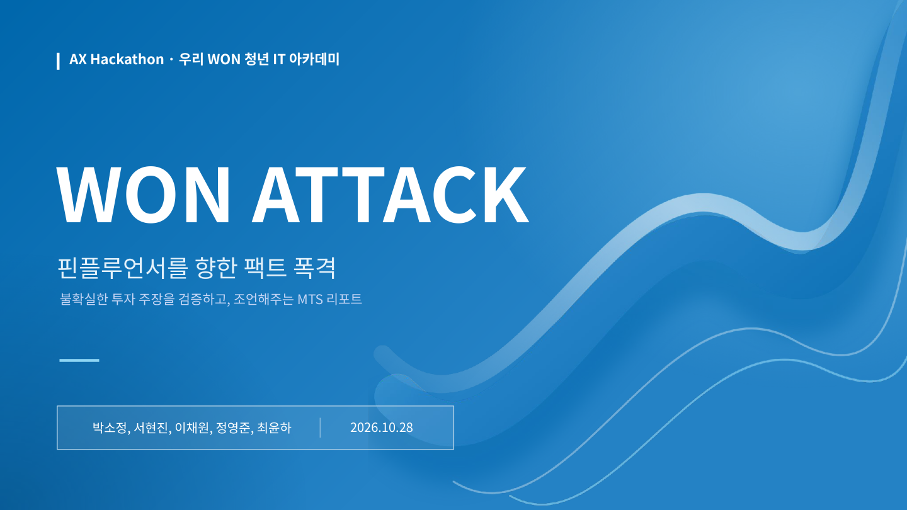
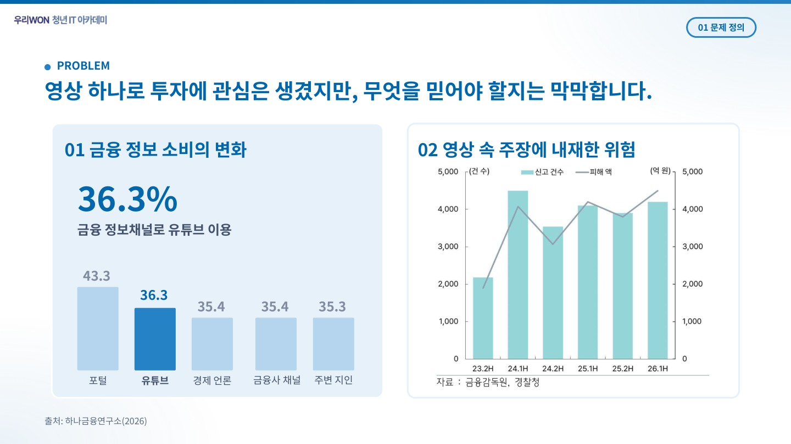
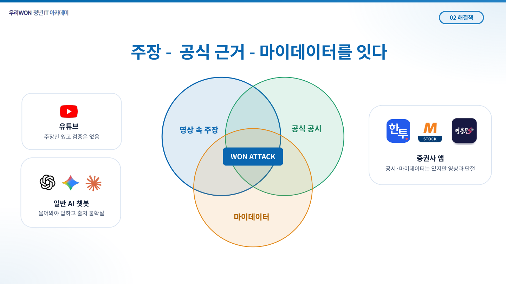
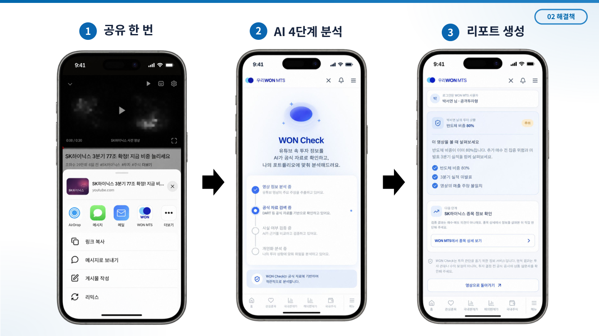
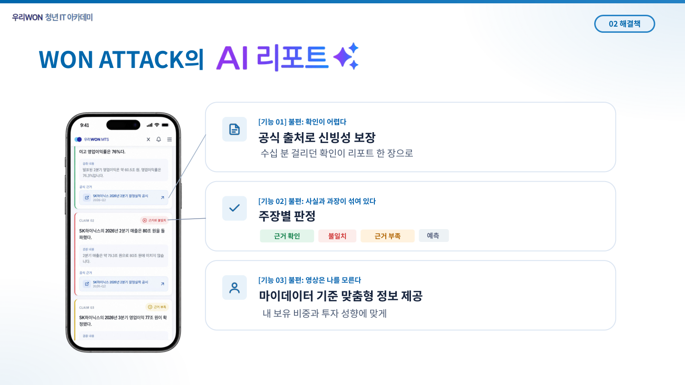
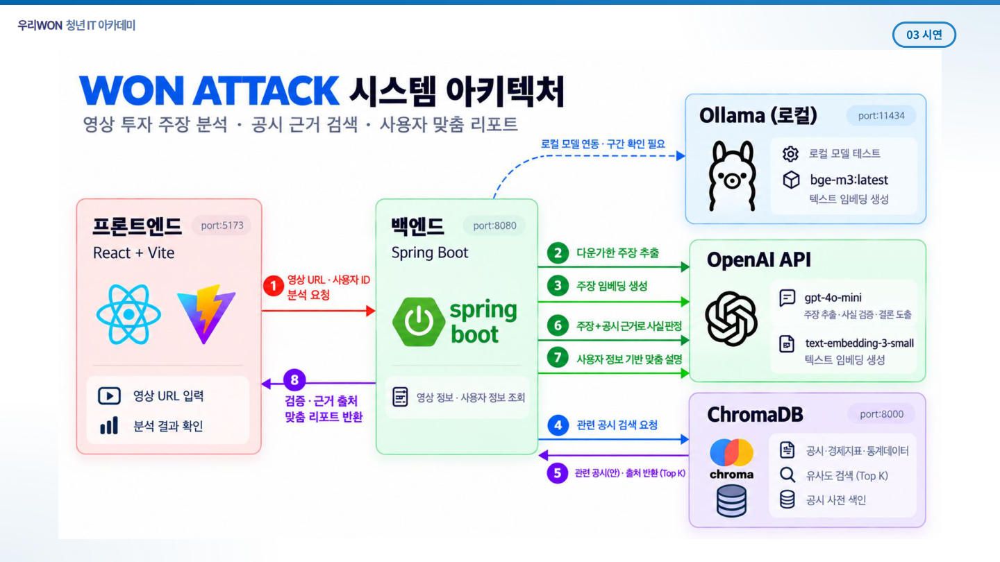
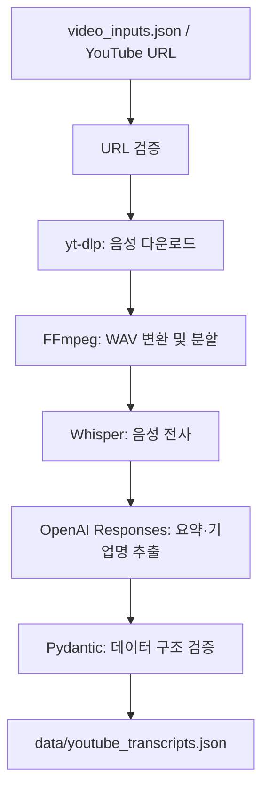
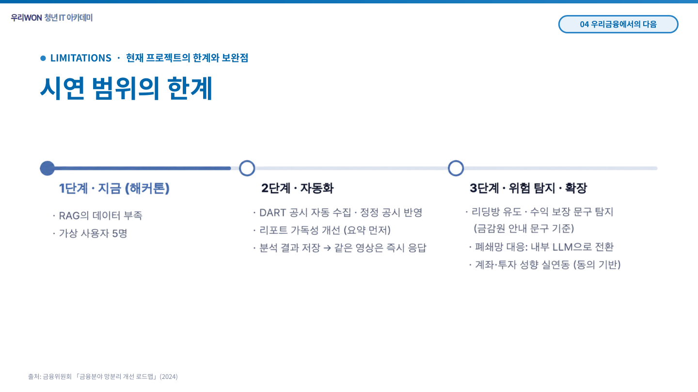

# WON ATTACK

**핀플루언서 투자 주장과 공식 근거를 연결하는 AI 투자 정보 검증 서비스**  
**정영준 | 서비스 기획 · 백엔드 개발 | 5인 팀 · 3일 해커톤 · 2026.10**

> 금융 정보는 쉽게 접할 수 있는데, 영상 속 투자 주장은 어떻게 검증할 수 있을까?  
> 금융권 리서치를 바탕으로 YouTube와 MTS 사이의 정보 단절을 분석하고, 투자 영상의 주장과 근거를 연결하는 서비스를 기획했습니다. 
> YouTube 영상의 음성 추출·전사·JSON 구조화를 위한 `pipeline.py`를 처음부터 끝까지 직접 작성했습니다.

[팀 GitHub 저장소](https://github.com/won-attack/won-attack) · [`pipeline.py` 소스](https://github.com/won-attack/won-attack/blob/main/pipeline.py) · [전사 파이프라인 문서](https://github.com/won-attack/won-attack/blob/main/docs/youtube-pipeline.md)

## 1. 프로젝트 개요

| 구분 | 내용 |
| --- | --- |
| 프로젝트 | WON ATTACK — 핀플루언서를 향한 팩트 폭격 |
| 참여 | 우리 WON 청년 IT 아카데미 AX 해커톤 |
| 기간 | 3일, 2026년 10월 완료 |
| 인원 | 5명 |
| 목표 | 영상 속 투자 주장을 공식 근거와 대조하고, 사용자의 투자 상황을 고려한 정보를 리포트로 제공하는 MVP |
| **내 역할** | **문제 정의·서비스 핵심 기능 제안, 가상 투자 영상 3편 제작, `pipeline.py` 전체 작성** |

> **기여 범위:** 본인의 직접 구현은 Python 영상 전사 파이프라인과 시연 콘텐츠 제작입니다. React 화면, Spring Boot 분석 백엔드, ChromaDB 검색, AI 판정 시스템은 팀 전체 시스템 구성 요소로 구분합니다.

## 2. 문제 발견 — 정보의 접근성과 신뢰성 사이

핀플루언서 관련 금융기관 보고서 및 금융당국의 경고를 보면서, 투자 콘텐츠를 소비하는 사람이 검증 근거를 충분히 확인하기 어렵다는 문제에 주목했습니다. 나 자신도 유튜브를 통해 투자 정보를 접하는 사용자이기에 이 문제를 개인적인 사용자 관점에서도 이해할 수 있었습니다.

하나금융연구소의 2026년 보고서에 인용된 금융 정보채널 이용률 조사에서는 유튜브가 **36.3%**로 나타납니다. 이는 금융정보 채널 *이용률*이며, 유튜브 이용자가 실제로 잘못된 투자 결정을 내린 비율을 뜻하지는 않습니다.

**핵심 타깃:** 연령 자체보다 행동을 기준으로, YouTube·SNS·리딩방에서 투자 정보를 얻지만 사실 여부와 근거를 검증하는 데 어려움을 겪는 초보·소액 투자자.

## 3. 서비스 기획 — YouTube·GPT·MTS의 단절을 연결

기획 과정에서 각 서비스의 장점보다 **연결되지 않는 지점**에 집중했습니다.

| 기존 접점 | 제공 가치 | 발견한 공백 |
| --- | --- | --- |
| YouTube | 투자 관련 영상에 손쉽게 접근 | 영상 속 주장과 검증 가능한 출처의 연결 부족 |
| 일반 AI 챗봇 | 자연어 기반 정보 해석 | 사용자의 질문이 필요하며 답변 근거를 별도로 확인해야 할 수 있음 |
| MTS | 공시·계좌·투자 정보 | 사용자가 시청한 영상의 주장과 투자 정보가 분리됨 |

### 직접 제안한 세 가지 방향

1. **주장 검증:** 영상에서 도출한 투자 주장과 확인 가능한 공식 공시 등 근거를 연결.
2. **공유 → MTS 리포트:** 사용자가 시청하던 영상을 공유한 뒤 검증 정보를 확인하는 사용자 흐름.
3. **개인화된 설명:** 동일한 주장이라도 보유 비중과 투자 성향에 따라 의미·유의점이 다를 수 있다는 관점 반영.

이는 **직접 제안한 기획 방향**입니다. 세 기능이 상용 서비스 수준으로 완성·검증되었다는 의미는 아닙니다.

## 4. 팀 시스템과 기술 사용 맥락

| 기술 | 사용 맥락 | 역할 구분 |
| --- | --- | --- |
| **Python** | YouTube 전사·구조화 파이프라인 | **직접 구현** |
| **yt-dlp, FFmpeg** | 영상 음성 다운로드·변환·분할 | **`pipeline.py`에서 사용** |
| **Whisper / OpenAI API** | 음성 전사, 구간별 정보 구조화 | **`pipeline.py`에서 사용** |
| **Pydantic** | 출력 JSON과 시간 구간 검증 | **`pipeline.py`에서 사용** |
| **Remotion** | 사전 대본 기반 가상 투자 영상 제작 | **영상 3편 제작** |
| Spring Boot | 서비스 API 및 분석 백엔드 | 팀 시스템 |
| React + Vite | 시연 UI·리포트 표시 | 팀 시스템 |
| Ollama | 로컬 LLM 처리 | 팀 시스템 |
| ChromaDB | 사전 적재된 공시 근거 검색 | 팀 시스템 |

> 발표자료의 아키텍처는 **팀 전체 흐름**입니다. 아래 Mermaid 다이어그램은 **본인이 작성한 별도 Python 파이프라인**을 설명합니다.

## 5. 개인 백엔드 기여 — `pipeline.py` 전체 작성

가상 영상은 사전에 대본을 준비할 수 있었지만, 사용자가 실제 YouTube 링크를 입력한다면 별도 데이터 확보 과정이 필요했습니다. 이 요구를 위해 URL 입력부터 전사 결과의 구조화까지 처리하는 `pipeline.py`를 직접 작성했습니다.

### 구현 범위

- YouTube URL 검증 및 영상 음성 확보 로직 작성
- FFmpeg를 통한 음성 변환, 청크 분할 처리
- Whisper 전사와 시간 구간 정보 처리
- OpenAI API를 통한 구간별 요약·기업명 등 구조화
- Pydantic으로 출력 형식 및 타임스탬프 검증
- 사전 시연용 `data/transcripts.json`과 분리된 `data/youtube_transcripts.json` 출력 구조

코드에 **600초 청크 분할 및 기본 최대 영상 길이 900초** 설정이 존재합니다. 이 수치는 *코드 설정*이며, 해당 길이까지 처리 성능이나 정확도를 검증했다는 성과 지표가 아닙니다.

**근거:** [`pipeline.py`](https://github.com/won-attack/won-attack/blob/main/pipeline.py), [전사 파이프라인 문서](https://github.com/won-attack/won-attack/blob/main/docs/youtube-pipeline.md).

## 6. 기술적 문제 해결 — 사전 대본과 실제 URL 입력의 차이

### 상황

초기 시연에서는 직접 작성한 대본으로 가상 투자 영상 3편을 제작했습니다. 그러나 임의의 YouTube 링크를 처리하려면 미리 확보된 대본 대신 음성에서 텍스트를 추출해야 했고, **기존 시연 데이터와 새 URL 기반 데이터의 입력 경로 차이**를 다루는 것이 어려웠습니다.

### 실제 대응

- 신규 URL 영상을 위한 Python 전사·구조화 파이프라인 작성
- 기존 시연용 데이터와 신규 영상의 결과 파일을 분리하도록 구현
- 3일 일정의 시연에서는 직접 작성한 대본 기반 약 30초 영상 3편 활용
- 실제 YouTube 영상 1개는 사전에 대본을 확보해 후속 비교용 데이터 준비

**구현과 검증의 구분:** 파이프라인 코드 구현은 확인되지만, 실제 영상의 자동 전사부터 JSON 생성까지 전체 성공의 실행 주체·경위는 현재 기억만으로 확정하지 않습니다. 저장소 문서에는 실행 테스트 기록이 있으나 이를 본인의 검증 성과로 단정하지 않습니다.

### 사후 기술 비교 — 당시의 선택 이유로 소급하지 않음

당시 여러 방식을 체계적으로 비교해 선정한 것은 아닙니다. 완성 후 돌아보면 아래와 같은 대안이 있습니다.

| 대안 | 장점 | 한계 |
| --- | --- | --- |
| YouTube 자막 활용 | 음성 전사 없이 텍스트 확보 가능 | 자막 미제공·접근 제한에 취약 |
| **Whisper 음성 전사(실제 구현)** | 자막 없는 영상에도 대응할 수 있는 경로 | 인식 오류, 처리 시간·비용 관리 필요 |
| **사전 대본 활용(실제 시연)** | 입력 내용이 일정해 시연 조건을 통제 | 새로운 영상으로 일반화 불가 |

후속 설계에서는 **입력 경로는 구분하되 후속 분석용 출력 스키마는 통일**하는 방식을 검토할 수 있습니다. 이는 개선 제안이지 당시 완료한 통합 분기 기능이 아닙니다.

## 7. 결과와 한계

### 확인 가능한 개인 산출물

- 주장 검증, 공유 → MTS 리포트, 개인화 설명 기능 **직접 제안**
- YouTube 음성 추출·전사·JSON 구조화 `pipeline.py` **전체 작성**
- 대본 기반 가상 투자 영상 **3편 제작**
- 실제 YouTube 영상 1개에 대한 **사전 대본 및 JSON 비교용 데이터 준비**

### 팀 수준의 시연 결과

팀은 공시 근거 검색과 주장별 판정, 사용자 맞춤 정보 제시를 포함한 MVP 시연 구성을 발표했습니다. 개별 기능의 전면적인 실서비스 검증 결과로 해석하지 않습니다.

### 미검증·제한 사항

- 실제 영상 자동 전사 및 JSON 생성의 개인 실행·검증 경위
- 다양한 영상 길이·음질·자막 유무별 전사 정확도
- 사전 대본과 실제 URL 입력의 자동 통합 분기 처리
- 실제 계좌 데이터 기반 개인화 및 광범위한 공식 공시 데이터 검증

## 8. 배운 점과 다음 개선 계획

**기획:** 개별 제품의 기능을 나열하기보다 사용자 행동에서 끊기는 지점(영상 소비 → 근거 검증 → 투자 판단)을 연결하는 것이 중요했습니다.

**백엔드:** 후속 AI 분석의 품질을 위해 영상 데이터를 일정한 구조로 변환하는 과정과 입력 데이터의 검증이 필요하다는 점을 경험했습니다.

**개발 범위 관리:** 작성한 코드와 실제 검증된 처리 경로를 구분해야 합니다. 짧은 기간에는 사전 대본을 활용한 시연과 실제 URL 처리 코드를 병행했고, 둘의 검증 수준이 다르다는 점도 남았습니다.

**향후 계획**

1. 영상 길이·자막 유무·음질에 따른 전사 결과를 정답 대본과 비교
2. 사전 대본과 자동 전사의 출력 스키마를 통일하고 입력 분기를 테스트
3. 전사 결과 → Spring Boot 분석 → 공시 근거 검색을 통합 테스트
4. 투자자가 판정 근거를 이해할 수 있는지 사용자 시나리오로 검증

## 9. 관련 링크와 근거

- **[WON ATTACK 팀 저장소](https://github.com/won-attack/won-attack)**
- **[직접 작성한 `pipeline.py`](https://github.com/won-attack/won-attack/blob/main/pipeline.py)**
- [YouTube 전사 파이프라인 문서](https://github.com/won-attack/won-attack/blob/main/docs/youtube-pipeline.md)
- [영상 제작 관련 `video/` 디렉터리](https://github.com/won-attack/won-attack/tree/main/video)
- 팀 최종 발표자료(2026.10.28): 역할 분담(3쪽), 문제 정의(5쪽), 차별화(9~10쪽), 사용자 흐름(11~12쪽), 아키텍처(15쪽), 한계(17쪽)
- 하나금융연구소, **「핀플루언서, 자유와 책임의 균형 — 미등록·무자격 활동 규제 현황」**, Hana Knowledge 제31호(2026.09.11), 본문 3쪽 금융 정보채널 이용률

---

